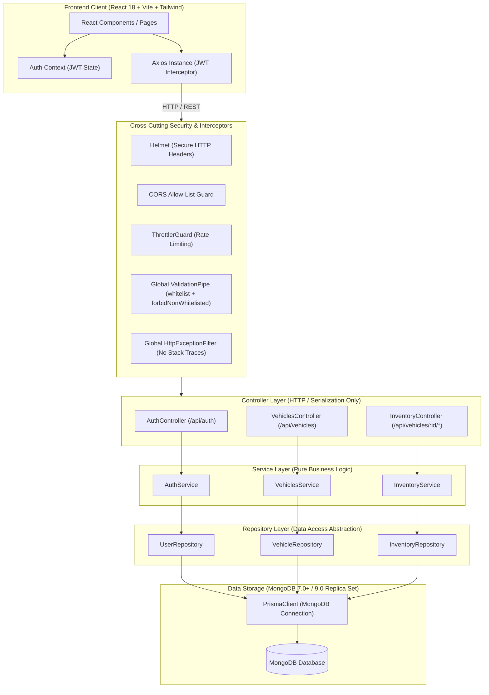
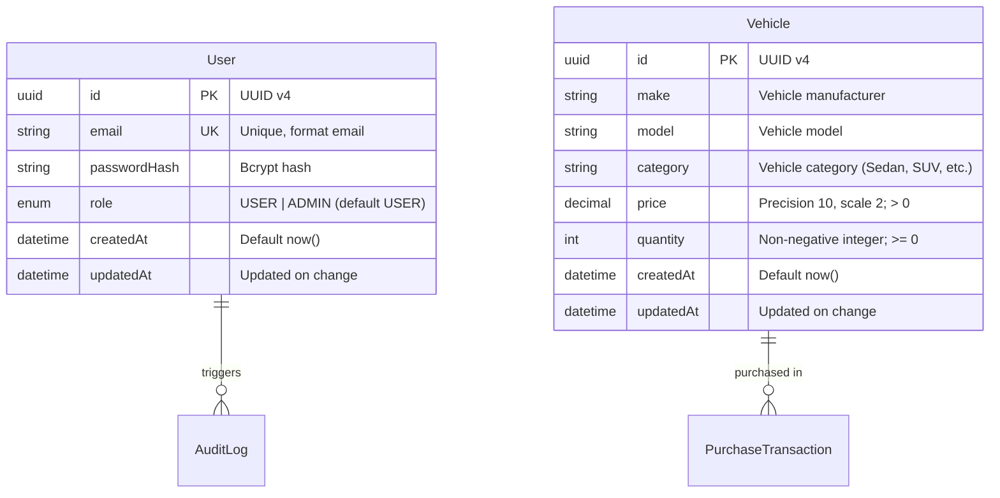
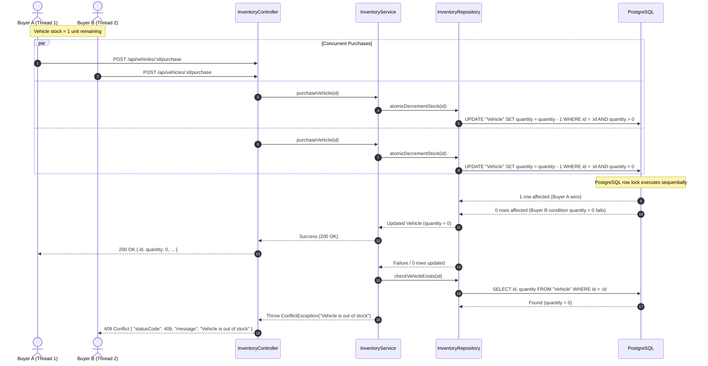

# Car Dealership Inventory System — System Design & Architecture

## 1. Architectural Overview & SOLID Principles

The system adopts Clean Architecture and strictly adheres to SOLID design principles using NestJS Dependency Injection:



### SOLID Principles Applied
1. **Single Responsibility Principle (SRP)**:
   - Controllers handle HTTP routing, query parsing, and response status mapping.
   - Services implement business validations, hashing, and domain algorithms.
   - Repositories encapsulate database-specific queries and Prisma operations.
2. **Open/Closed Principle (OCP)**:
   - Guards (`JwtAuthGuard`, `RolesGuard`) and Interceptors decorate routes cleanly without modifying controller internals.
3. **Liskov Substitution Principle (LSP)**:
   - Concrete repositories implement clean interfaces (`IVehicleRepository`, `IUserRepository`), allowing mock repository implementations in unit tests without changing service behavior.
4. **Interface Segregation Principle (ISP)**:
   - DTOs are fine-grained: `CreateVehicleDto`, `UpdateVehicleDto`, `SearchVehicleDto`, `RestockVehicleDto`, `RegisterDto`, `LoginDto`.
5. **Dependency Inversion Principle (DIP)**:
   - Services and Controllers depend on abstractions injected via NestJS DI tokens, enabling painless test isolation and mock substitution.

---

## 2. Entity Relationship Diagram (ERD)



---

## 3. Atomic Concurrency Sequence (Race-Safe Vehicle Purchase)

Preventing negative stock when concurrent requests arrive for the last available vehicle:



---

## 4. API Contract Summary

| Method | Endpoint | Auth | Role | Request Body | Success | Error Codes |
|---|---|---|---|---|---|---|
| `POST` | `/api/auth/register` | None | Anyone | `{ email, password }` | `201 Created` | 400 (Validation), 409 (Email exists) |
| `POST` | `/api/auth/login` | None | Anyone | `{ email, password }` | `200 OK { accessToken, user }` | 400 (Malformed), 401 (Invalid creds) |
| `POST` | `/api/vehicles` | JWT | Any Auth | `{ make, model, category, price, quantity }` | `201 Created` | 400 (Invalid), 401 (Unauthorized) |
| `GET` | `/api/vehicles` | JWT | Any Auth | Query: `?page=1&limit=10` | `200 OK { data, meta }` | 401 (Unauthorized) |
| `GET` | `/api/vehicles/search` | JWT | Any Auth | Query: `?make=&model=&category=&minPrice=&maxPrice=` | `200 OK { data, meta }` | 400 (`minPrice > maxPrice`), 401 |
| `PUT` | `/api/vehicles/:id` | JWT | Any Auth | `{ make?, model?, category?, price?, quantity? }` | `200 OK` | 400 (Invalid), 401, 404 (Not Found) |
| `DELETE` | `/api/vehicles/:id` | JWT | `ADMIN` | None | `204 No Content` | 401, 403 (Forbidden), 404 (Not Found) |
| `POST` | `/api/vehicles/:id/purchase` | JWT | Any Auth | None | `200 OK` | 401, 404 (Not Found), 409 (Out of stock) |
| `POST` | `/api/vehicles/:id/restock` | JWT | `ADMIN` | `{ amount: number }` | `200 OK` | 400 (`amount <= 0`), 401, 403, 404 |

---

## 5. Security Architecture & Threat Modeling (OWASP Top 10)

1. **A01: Broken Access Control**:
   - NestJS `JwtAuthGuard` applied across all inventory and vehicle routes.
   - `RolesGuard` combined with `@Roles(Role.ADMIN)` strictly enforces admin authorization for DELETE and restock.
2. **A02: Cryptographic Failures**:
   - Passwords hashed with bcrypt (salt cost 10).
   - Sensitive environment variables (`JWT_SECRET`, database URLs) strictly isolated from version control.
   - Password hashes explicitly stripped via class-transformer `@Exclude()` and service sanitization.
3. **A03: Injection (SQL / NoSQL)**:
   - Prisma ORM utilizes parameterized queries exclusively. Zero raw unparameterized SQL concatenation.
4. **A04: Insecure Design**:
   - Race conditions handled atomically at database level using conditional row updates.
5. **A05: Security Misconfiguration**:
   - `helmet` secures HTTP response headers (X-Frame-Options, Content-Security-Policy, etc.).
   - Explicit CORS origin allowlist configured via environment variable `CORS_ORIGIN`.
   - Global exception filter strips internal stack traces from responses.
6. **A07: Identification and Authentication Failures**:
   - Throttling on `/api/auth/*` protects against brute-force login attempts.
   - Generic error responses: `"Invalid credentials"` returned for both unknown emails and incorrect passwords.
7. **A08: Software and Data Integrity Failures**:
   - `ValidationPipe` with `forbidNonWhitelisted: true` and `whitelist: true` blocks unexpected payload properties.

---

## 6. Frontend Architecture

### Directory Layout
```
frontend/
├── src/
│   ├── components/      # UI components (Navbar, VehicleCard, VehicleModal, RestockModal, Skeleton, Toast)
│   ├── context/         # AuthContext, AuthProvider, useAuth
│   ├── hooks/           # useVehicles, useDebounce
│   ├── pages/           # LoginPage, RegisterPage, DashboardPage, NotFoundPage
│   ├── services/        # api.ts (Axios instance with JWT interceptor)
│   ├── types/           # Vehicle, User, AuthState, ApiResponses
│   ├── App.tsx          # React Router setup & ProtectedRoute guards
│   ├── main.tsx         # Root entrypoint
│   └── index.css        # Tailwind directives & design tokens
├── tailwind.config.js
├── vite.config.ts
└── package.json
```

### State & Interaction Flow
- Authentication state is initialized from `localStorage` on boot.
- Route guards redirect unauthenticated users to `/login`.
- Vehicle grid supports live search with 300ms debounce.
- Purchase buttons show instant spinner, optimistic or refetched quantity update, and toast notifications.
- Admin badges and administrative action buttons (Add, Edit, Delete, Restock) are conditionally rendered based on JWT decoded claims.
